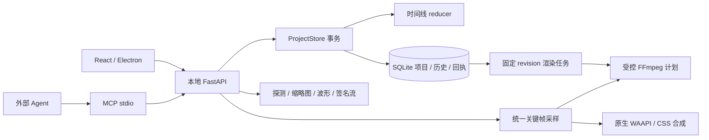

# 软件架构

人工桌面与外部 Agent 修改同一份 SQLite 项目。React/Electron、MCP 都通过本地 HTTP 服务提交契约命令；reducer 是唯一编辑规则入口。

## 数据与事务

项目 schema v10，兼容读取 v1–v9；数据库 user_version=2。Track 有静音、隐藏、音量、锁定；Clip 有整数位置、源入点、时长、速度百分比、变换、关键帧、颜色、可选文字、形状遮罩、入场转场、持久组合和音画链接。

组合与链接是 Clip 上的关联 id。组合只影响选择，不构造嵌套渲染图；音画链接记录源入点差值作为人工对齐后的同步基准。共享 reducer 负责设置/解除、联动修剪、切分右半段链接 id 与孤立关联清理。只在整批结束清理，允许同批复制或跨轨切分。`preview-manifest.links` 报告权威同步状态与位置/源/长度/速度差异；独立编辑允许失步，联动修剪拒绝已失步的链接。界面只展开选择和画候选几何，保存仍调用同一命令。
固定 70,560,000 tick/秒；帧率 numerator/denominator；视频、图片、文字按序列帧对齐，音频按采样对齐。源入点属于源时钟，不能强制按序列帧取整。同轨重叠只允许明确的两镜头转场，后面的画面轨覆盖前面的轨。
clip.insert / clip.overwrite 与 clip.split 共用区间截取函数；截取先保存原源时间与动画偏移，再执行位置顺延。插入的同步轨道是显式契约参数；覆盖只裁切目标轨道重叠部分。生成片段 id 使用确定性摘要，预演与提交不会出现随机差异。
clips.add / move / remove / split 是同一 reducer 的原子组命令，不展开为可能破坏中间转场的单片段操作。组移动统一 delta，可显式映射原轨道到目标轨道；统一最终校验。组分割复用单片段截取；涟漪删除按轨合并选择区间，减去存活片段仍使用的部分，再按前缀时长移动后续内容。

每次写入携带 request_id 与 expected_revision。先读取回执，再检查版本；深拷贝执行完整批次，最终验证，再在同一 SQLite 事务中持久化项目、历史与回执。失败整体回滚；dry-run 不写库；恢复生成新版本。
新增字段的默认值从请求指纹中剔除，保持旧请求重放语义；不可修改已提交历史。SQLite 使用 WAL 与 BEGIN IMMEDIATE，当前单个写者足以服务本地人工和 Agent。
文字 align/box 默认值也参与兼容归一化，并接受 1.7 已落盘的旧格式指纹；不同正文仍拒绝重放。工程包导入作为新快照在同一事务中提交项目、服务探测记录、历史和回执；不通过逐条剪辑重建，因此允许恢复锁轨与空工程。上传/导出使用临时文件流，解包路径由服务创建，失败与并发重放的临时素材目录会清理。

## 动画、变速与文字

animation.py 是十项属性的曲线权威实现：六项画面属性（x、y、scale、rotation、opacity、gain）与四项遮罩盒参数（mask_x、mask_y、mask_width、mask_height）。linear/hold/ease/bezier 同时编译为 FFmpeg 表达式与浏览器原生动画；被修剪的缓动段保留端点切线。分割、左缘修剪保存 animation_offset_ticks，保证画面连续。
数值曲线编辑器从只读 animation/curve 读取 SVG 几何，与 preview-manifest 共用 property_curve；裁剪后的端点/切线与 render sample 一致。keyframe.move 复用 reducer 的锁轨与事务边界，检查原点、目标占用后一次替换；拖动捕获工程 id/revision 防止旧手势写入新快照。
浏览器从服务读取 sample 显示数值；不在前端另写动画采样器。原生 Web Audio GainNode 支持 0..4 音量；源媒体和监听静音与导出共用轨道规则。
speed_percent 为整数，受控 setpts/atempo 与原生 playbackRate 实现 0.25..4 倍速并保留音高。变速保持原消费源范围，将结果时长向下对齐帧或采样；可原子移动同轨后续片段。动画仍使用时间线时间。
文字是合成素材而不是一个伪造的媒体探测记录。SRT 在 reducer 解析并创建文字片段，导入重叠或格式错误回滚整个批次。输出将正文存入隔离任务目录的 UTF-8 文件，禁止 drawtext 展开表达式。

## 媒体与渲染

文件导入必须在授权根内，由服务读取、探测、哈希并签发媒体记录。reference 仅是元数据，渲染不使用任意客户端路径或 FFmpeg 参数。
单轨普通剪辑使用直切 concat；分层、文字和视觉变换使用透明层 overlay。静态默认变换跳过缩放、旋转及逐像素透明度处理。颜色处理使用 RGB 明度/对比度与 CSS 饱和度矩阵。
transitions.py 为画面权重、声音权重和淡黑中性层的唯一曲线来源；预览用每轨隔离的 CSS plus-lighter，FFmpeg 对转场轨逐层预乘、相加、恢复透明度后覆盖底层，避免半透明画中画中点额外变暗。转场轨当前生成整段透明画布；长 4K 多层工程的内存与速度仍需验收，实测出现瓶颈再分段编译。
持久化任务锁定项目 revision，读取不可变历史，受控 subprocess 执行；先输出 `.part.<容器>`（容器由预设决定，1.57 起不再固定 mp4），**发布前先复检**（1.60）：`ffprobe_beside` 取这次跑的 FFmpeg 的同目录兄弟，`verify_output` 用它比对容器成员、流种类（按计划该有画面就得有画面、纯音频就不许夹画面、声音恒必在）、时长与 `max(0.150 秒, 两帧)` 容差，再用同一个 ffmpeg 把结尾 0.5 秒解码一遍——faststart 的 MP4 截到 30 % 字节头部仍报 3.000000 秒，只有尾部解码能认出 `partial file`；任一条不合格就删掉候选、以 `OUTPUT_INVALID` 失败，最终文件名一次都不出现。旁边没有 ffprobe 时任务仍成功，但 `output_checked=false` 且 message 写明未经复检（`--ffprobe` 那一份是入库探针，不复用来量交付）。复检通过才原子发布。取消终止进程树并清理半成品；重启把中断任务标记失败。正文缓存目录为 render-assets/{job_id}，只保存受控摘要文件名。

## 桌面与边界

Electron 管理本地引擎生命周期与凭证；renderer 不读取数据库。桌面提供可调整面板、素材预览、逐帧合成监视器、磁吸、拖拽修剪、锁轨、检查器、字幕、导出与历史。
素材监视器使用独立源播放头；I/O 标记本会话素材范围，出点包含当前帧，提交时转换为不包含结束的整数区间。标记按文件内容指纹保留，切换素材可继续使用；目标轨道与同步选项明确显示。F9/F10 提交统一插入/覆盖命令，不在界面裁切时间线。小窗口下暂时压缩时间线高度，为素材画面和区间控件保留空间；全屏保持项目画幅。
示波器测量统一导出图生成的合成帧，包含叠层、动画、文字、调色与转场。每次至多一笔请求，500 ms 检查播放头变化，界面标出实际采样时间；源监视器不混作合成测量。当前使用最长边 256 的低分辨率取样和输出端寻帧，长工程会慢于播放头，尚未提供实时 4K / HDR 色彩测量。
编辑按项目串行；排队命令不能应用到切换后的工程；同项目载入最新版本保留待提交批次并重新预演。跨项目切换前必须提交或放弃批次，避免静默丢失。
浏览器预览受本机原生解码器限制，与 FFmpeg 的字体栅格化、像素取整、音频块插值存在微小差异；4K 长工程、帧级拖动性能未完成专项验收。
当前每次历史保存全量快照；达到实测瓶颈后再压缩或检查点，不能先删除回执。备份 SQLite 应用 backup API，不能只复制 WAL 模式下的主文件。
多选状态与剪贴板仅保存在本次应用会话；复制保存素材、轨道、源/动画时钟和组内转场的独立快照，粘贴显式登记目标工程缺少的素材/轨道并重映射 id。服务再次验证媒体凭证。移动和粘贴的 delta 按涉及轨道的帧/采样步长最小公倍数对齐；不同工程帧率下不自动重采样，不合法最终状态明确拒绝。跨工程粘贴新建未锁定轨道；即时操作整组一次撤销。
仅监听 127.0.0.1，未实现多用户、云素材、任意第三方插件。遮罩跟踪、路径遮罩关键帧、节点图色彩（并联/分层、亮度曲线、LUT 与色彩管理）与自动字幕仍是后续工作，不声明全面替代专业软件。

## 调色节点（1.16）

grade.py 是每通道传递函数的唯一编译处：把 ClipColor.grade 的启用节点按顺序合成为一条输入轴折线（65 点基准栅格与控制点位置取并集，近共线点合并），再从这条折线导出两份产物——FFmpeg `lutrgb` 的分段线性表达式，和 preview-manifest 里每片段 `grade:{id,r,g,b}` 的 256 项表。浏览器用 `feComponentTransfer type="table"` 与 `color-interpolation-filters=sRGB` 应用同一张表，因此调色预览与导出是同一个函数，而不是两套近似实现；节点链为空或恒等时两份产物都不存在，渲染图不增加任何滤镜。链路排在原有曝光/对比度/饱和度之后，界面 CSS 滤镜列表也按同序组合。`.cube` 查找表也只有这一处读取：`parse_1d_cube` 是引擎里唯一的 LUT 解析器，桌面界面把文件文本 POST 到 `/v1/lut/parse`、Agent 用同一个工具，拿回的就是可直接入链的 `GradeLUT` 载荷（等距网格、线性插值、越界值夹住、超过 `LUT_SAMPLE_LIMIT` 就重采样并回报 `resampled_from`），客户端不第二遍解释文件；只接受 1D，因为 3D 表跨通道混合就不再是每通道函数，这份架构不假装能替它做决定。

每个节点另带 mix 强度：先算节点结果，再按 out=in+mix*(node(in)-in) 与该节点输入逐通道插值（达芬奇的 Mix 语义），所以整条链仍折叠成同一条每通道折线，mix 全为 0 与停用节点一样不产生任何滤镜、不申请 LUT。节点全部只依赖本通道数值：曲线为分段线性（端点外保持），白平衡为逐通道增益，RGB 增益为 `gain*in^(1/gamma)+lift` 并逐节点钳位。曲线节点的 y 允许超出 0..1，由链尾钳位实现压黑/溢出。表达式只由数值拼接，不引入调用方文本；`clip.grade` 与 `clip.patch.color.grade` 共用原 reducer、锁轨、整批回滚、request_id/expected_revision 与历史，schema v10 兼容读取 v1–v9，color 中的默认 `grade` 已从请求指纹剔除以保留旧回执重放。

## 形状遮罩与候选画面

masks.py 把同一标准化几何编译为 FFmpeg alpha 表达式与浏览器原生 SVG mask；遮罩乘以已有素材透明度，在适配工程画布后、片段缩放/旋转/平移之前应用。矩形羽化为两轴向内线性乘积，椭圆为径向向内线性渐变，反转使用 1-alpha。拆分/修剪保留遮罩；拆分声音清除声音副本的遮罩。clip.mask 共用 reducer、锁轨与事务。

只读 POST /v1/preview-manifest 验证完整候选工程，生成与正式预览相同的动画、颜色、转场和遮罩计划；不导入候选 metadata 中的路径，播放继续使用经过验证的服务端素材流。画面拖拽用原生 SVG 坐标矩阵，草稿经只读 mask/preview 编译，松开仅提交一次并捕获 id/revision。预览计划刷新保留同工程媒体节点和键盘焦点，计划未就绪时暂停播放。矩形/椭圆的盒参数可关键帧（见下节），路径遮罩的顶点动画与跟踪仍未实现。

## 自由路径遮罩（1.17）

masks.py 对路径遮罩只做一次几何：顶点 + 相对控制柄先按弦高自适应细分成折线，再用 4 子行偶奇扫描线求每像素覆盖率，需要羽化时做可分离高斯，最后写成灰度 PNG。FFmpeg 侧把该 PNG 作为 `-f image2 -loop 1` 静止输入，`alphaextract` 出源 alpha、`scale2ref` 对齐帧尺寸、`blend=all_mode=multiply` 相乘后 `alphamerge` 合回，因此不透明度动画、缩放/旋转、转场权重与轨道混合继续按既有链路叠加，不必逐像素判定多边形。浏览器侧使用同一顶点表的 SVG `<path>` 数据 URI，viewBox 取 1000 单位的等比坐标，使 `feGaussianBlur` 的 stdDeviation 与 PNG 的像素半径一致。`/v1/mask/preview` 只读，不写库。

## 曲线变速（1.18）

speed.py 是速率曲线的唯一权威：一条 0–400% 的折线先按节点和陡度分成不超过 48 段的恒定速率，每段的时间轴/素材边界都对齐到帧（视频轨）或采样（声音轨）时钟，切分粒度统一由帧时钟决定（声音也只在画面的切换点改速率，按采样时钟切会把 4 秒曲线切成 47 段 83 ms 碎片、换速接缝打出咔哒声），相邻段共用累积源位置，所以既不会跳帧也不会重帧；段总源长等于时间线校验用的积分，冻结段（速率 0）记录 `hold` 为窗口内真实存在的最后一帧。render.py 拿这份分段生成图：`split` 出等长流，每段 `trim + setpts*(timeline/source) + fps` 后 `concat`，冻结段取 `hold` 帧再 `tpad=stop_mode=clone`，声音用 `atrim + atempo…` 与 `apad` 静音，输入 `-t` 用积分窗口而不是固定倍速窗口，因此四倍速曲线仍可读满四倍素材。preview-manifest 把同一分段以秒制（`describe`）发给界面，`desktop/src/time.ts` 的 `pacing()` 逐帧据此设置 `playbackRate` 与 `currentTime`，速率为 0 时暂停保持 `hold` 帧——导出与浏览器预览是同一份近似，而不是两套曲线。

界面 Inspector 的「曲线变速」提供慢入/慢出/蒙太奇/冻结结尾预设与折线拖动，一次手势一个 revision，越界或与其它规则冲突由服务端整笔拒绝并显示原因；`clip.speed_curve` 与 `features.speed_curve` 走同一条 capabilities 通道，MCP 从契约自动获得该命令。

## 遮罩关键帧（1.20）

矩形/椭圆遮罩的盒参数（mask_x、mask_y、mask_width、mask_height）走 animation.py 的同一套曲线求值。导出时 render.py 对每个被关键帧的属性调用 `expression(clip, name, "T", registers)`，把它展开成以帧时间 `T` 为自变量的表达式，并给每段曲线分配一对 `st/ld` 逐帧缓存寄存器（同一帧只求值一次）；`masks.alpha_expression(mask, values)` 把原本写死的四个数字换成这些表达式，其余链路不变——椭圆仍是 `sqrt(pow(x,2)+pow(y,2))`，羽化仍是 `clip((1-r)/feather,0,1)`，因此软边缘是随盒子平移的斜坡，`geq` 以 `a='alpha(X,Y)*(…)'` 把遮罩乘在素材自身透明度上。

浏览器不重绘遮罩几何：preview-manifest 下发一张引擎编译的单位遮罩图（圆心 0.5/0.5、盒 1.0/1.0 的 SVG data URI）与每个属性的归一化控制点，`MaskPicture` 用四个注册成 `<number>` 的 `@property` 自定义属性驱动 `mask-size: calc(var(--mask-w)*var(--mask-lw)*1px)` 与 `mask-position: calc((var(--mask-x)-var(--mask-w)/2)*var(--mask-lw)*1px)`，图层像素尺寸由 ResizeObserver 写入 `--mask-lw/--mask-lh`。归一化坐标到像素的映射是线性的、与时间插值可交换，所以每一帧的浏览器遮罩与导出 alpha 落在同一条边界上；控制点交给 WAAPI 建立动画并暂停，播放头位置只改 `currentTime`。

约束仍只有一处：`validate_timeline` 用 `clip.mask_animation_problem()` 判断「有关键帧却没有可动画的盒遮罩」（无遮罩 / 路径 / 反相），返回 `INVALID_MASK` 带 `clip_id` 并整笔回滚。契约层那条重复的 model validator 已删除——reducer 逐字段改写片段时它根本不会触发，却会抢在权威校验之前把这条业务拒绝压成含糊的 `PROJECT_LIMIT`。

## 代理回放与缓存配额（1.21–1.22）

代理是**派生文件**，不是工程状态：media.py 的缓存目录按内容哈希寻址（`<hash[:2]>/<hash>/`），`proxy-<width>.mp4` 与缩略图、波形放在一起，旁边一份同名 json 记录探测得到的真实宽高、时长、帧率与源哈希。状态判定只信这份记录，源文件换了哈希就是另一个目录，绝不会把旧代理当成新的用。转码参数固定：`scale=<width>:<原高>:force_original_aspect_ratio=decrease` 只缩不放、`libx264 -preset veryfast -crf 27 -pix_fmt yuv420p`、`-r num/den` 保持源帧率、GOP 取两秒并 `-sc_threshold 0` 便于随机定位、`-movflags +faststart` 让 moov 前置以便边下边播，有声音才 `-c:a aac 128k` 否则 `-an`；先写临时文件，探测确认时长与源相差不超过两帧后才改名入库，否则删除并报 `PROXY_FAILED`。

三个端点：`GET /v1/projects/{id}/assets/{aid}/proxy?width=` 读状态、`POST` 同路径构建、`GET /v1/assets/{aid}/proxy/stream?project_id=&width=&sig=` 以 `proxy:{project}:{asset}:{width}` 签名流式读取。宽度只接受 640/960/1280/480，越界 `INVALID_REQUEST`；工程 revision、渲染计划与导出都不参与，`compile_render_plan` 的 argv 在构建前后逐字节相同。capabilities 的 `proxy_playback` 与 `media_ready` 绑定，没有 ffmpeg 时不声明可用。

界面在预览标题行提供「代理」下拉（关闭/640/960/1280），选择写进 localStorage——这是工作站偏好而不是工程属性，换人打开不会被偷偷改画质。就绪后 `app.streams` 用代理地址覆盖原片地址，监视器标出「代理 960p」；构建失败时如实回退原片并说明原因。

缓存只增不减会吃掉磁盘，因此配额与代理放在一起：默认 4 GiB（`AGENTCUT_PROXY_CACHE_BYTES` 可覆盖），构建成功后立刻检查总量，超限就从最久未使用的一份开始删且保护刚构建的那份；取流时把该文件的 atime 推到当前时间，所以淘汰顺序跟随实际播放而不是构建顺序（Windows 上不能依赖读取自动更新 atime，必须显式 `os.utime`）。回收范围只有 `proxy-*` 派生文件——源文件、`tile-*.jpg`、`wave.json`、`cache.json` 永不动；扫描时顺手删掉没有对应视频的孤儿 sidecar。`GET /v1/media/proxies` 汇总占用（不暴露服务器路径），`POST /v1/media/proxies/prune` 按 `max_bytes` 清理，两者都不产生 revision；界面在预览标题行显示「代理占用 x MB / n 份」与「清理代理」，清理后回退原片并提示实际释放的字节数。

## 画面轨混合

compositing.py 将完成的透明画面轨与下方不透明工程画布混合，FFmpeg blend 在 gbrap RGB 上处理颜色，alphaextract/alphamerge 恢复原轨 alpha，再 overlay。因此遮罩、透明度、空隙与转场权重不进入颜色混合函数。正常且没有转场的轨保留原直接 overlay 路径；非正常轨使用独立透明画布；混合模式独立于声音。

预览由服务器 track_blend_modes 指定原生 CSS mix-blend-mode，轨内 isolation 与 plus-lighter 保留转场包络。工程监视器使用隔离的纯黑底，避免单轨混合读到界面底色。现有真实合成帧/示波器与导出复用同一 render plan。长 4K 多层仍需专项性能验收。

## 连续属性修改

1.12 的 clip.patch 将稀疏字段在共享 reducer 中合并到当前片段，再用原 Effects/Color/TextStyle 模型校验；客户端不模拟 reducer，也不为保存一个字段补齐其它旧值。批次中的命令可独立删除；即时提交继续串行化。原完整替换命令保持旧语义，数据库结构与 schema v7 不变。

检查器选用已验证的候选快照，预演待完成/失败/过期时禁用修改；其时间、效果、文字、颜色、遮罩、混合模式与关键帧列表都读取同一快照。候选动画值经只读 animation/sample，由 animation.sample_values 调用同一 render sample，包含裁剪偏移。已提交 GET sample 亦复用此函数。迟到的旧 dry-run 错误不能覆盖当前批次结果。

## 嵌套合成（1.13）

Project.sequences 保存独立的 tracks/clips 和固定整数 duration_ticks；Asset.kind=sequence 通过 sequence_id 引用合成，不伪造文件探测记录。全部合成共享工程 settings 和 assets，修改内部图层会更新所有引用实例。一个工程只有一条 revision/历史链，恢复整份快照不会遗失内部状态。

EditBatch.sequence_id 选择编辑范围，timeline.sequence_view 只投影轨道与片段；apply_commands 完成同一 reducer 后写回根文档，验证整个工程并由同一事务提交。asset.remove 检查全部范围，sequence.remove 拒绝活跃引用和正在编辑的合成；未使用合成移除时一并移除它的合成素材。默认 sequence_id=None 从编辑/素材登记指纹中剔除，保持旧回执；渲染指纹只在选择合成时增加该 id，旧任务默认读为主时间线。

sequence.nest 为完整选区建立合成：按涉及轨道的帧/采样最小公倍数向下取共同起点，结束向上对齐帧，保留源入点、动画时钟、内部转场/链接/组、锁定/隐藏/静音/音量和轨道顺序。在最高选中画面轨上方创建正常混合、音量 1 的新画面轨，避免再次乘上原轨音量/混合。跨选区的关联/转场和夹在所选层之间的重叠镜头整笔拒绝。内部混合是独立合成，不读取外部底图，界面创建说明明确这一点。

递归渲染编译为一张受控 FFmpeg 图，重映射子图输入和标签，保留 RGBA 透明度/固定时长/声音，最后才转为 H.264 输出。父片段源裁切、变速、效果、遮罩、关键帧和转场继续使用原链路；不把内部编辑烘焙为无法修改的视频。混合按底图 alpha 加权颜色后恢复源 alpha，透明底/半透明底与浏览器 CSS 一致。循环、超过 8 层、总计/展开超过 20,000 片段明确拒绝。

区间导出不是第二次规划：`marked_range(project)` 是唯一读 `SequenceSettings.in_ticks/out_ticks` 的地方，`jobs.plan_for()` 是唯一把它翻成刻度的地方，计划预演、排队任务与 worker 三处共用。`compile_render_plan` 在 `[vout]`/`[aout]` 之后才追加 `trim=start_frame:end_frame` 与 `atrim=start:end`，所以区间成片用的是整片同一张合成图、同一次 `amix`、同一个母带增益与限制器；反过来「按区间重规划一遍」会让淡入淡出、转场权重与母带探测各算一遍，区间版本就不再是整片版本的那一段。`range` 只在非默认值时进入渲染去重指纹，旧回执继续原样重放；没有入出点却请求 `range=marks` 一律 `INVALID_MARKS`，不会静默出整片。

客户端 rootProject/rootCandidate 保留完整快照，project/candidate 仅显示当前范围；所有写入显式携带范围。切换范围前必须处理批次；即时队列记录工程+合成身份；消失合成的批次保持原范围，不能误提交到主时间线。切换范围重建监视器/时间线/曲线以取消旧手势，异步曲线编辑同时检查范围/版本。原生预览递归沿源时钟播放，父声音增益逐层相乘，WAAPI 在布局阶段更新后才同步声音，避免首帧增益读到旧值。浏览器连续播放率乘积超出 0.0625..16 时明确提示暂停逐帧/导出检查。

工程素材可进入/追加合成；复制收集依赖合成与素材，跨工程显式重新登记可信素材并重映射合成/素材 id。同工程复制实例共享内部内容。工程包包含完整 sequences 和根 assets 的实际文件；导入重新探测。独立合成导出与示波器都选择同一合成图和固定 revision。

当前没有独立合成分辨率/帧率、折叠变换或外部合成链接；长 4K 多层/深层性能仍需专项验收。

keyframes.move 与旧 keyframe.move 复用同一选择替换函数，先检查全部源/目标，再一次移除并写入；选区内目标互占允许，未选中点不得覆盖。keyframes.remove 与单点删除复用移除函数。曲线最终校验仍由 Project 合同执行，UI 仅计算手势候选位移，不保存第二套剪辑规则。

## 遮罩跟踪（1.23）

tracking.py 用归一化互相关跟随一个盒子，只用标准库和 FFmpeg：`decode_luma` 以 `-vf fps=..,scale=256:H:flags=area,format=gray` 把素材解成灰度小帧（一次管道读取，帧数上限 900），`track_box` 取遮罩中心一块边长不超过 √MAX_TEMPLATE(=96×54) 的模板，在上一帧位置周围做 ±search 的整数搜索：先用当前尺寸的模板 coarse(step 2)+fine(step 1) 定位，再在该中心附近 ±SCALE_RADIUS 按 `SCALES` 档位试尺寸。为什么不用绝对差——差的度量在面积等于模板的窗口上必然最小，分不清主体变大与主体离开；归一化相关衡量形状，尺寸才是可估计的量，而档位相对于**当前**尺寸，所以几倍的生长能被持续跟上。代价有界：模板边长与搜索半径都封顶，实测只跟随平移时每帧 20–24 ms，尺寸持续变化时每帧约 69 ms。可信度以最近 8 帧相关度中位数的 0.8 倍为下限（夹在 0.35 与 0.75 之间），低于它就转入匀速外推而不是接受一个假匹配；遮挡超过 `max_gap` 帧仍未回来则整段截断，停在最后可信帧并报 `lost_at`。模板始终取自第 0 帧（按当前尺寸重采样后才比较），所以目标被挡住又出现时重新找到的是原目标，而不是被一步步改成遮挡物。跟踪不估计旋转，也不看代理文件（分析始终读原片，代理只是预览副本）。

写入不另开一条路：分析端点算出 `points` 后，把它作为**一条** `clip.mask_track` 命令交给 `ProjectStore.mutate`，与 `/edits` 同一事务、同一 `request_id` 去重、同一 `expected_revision` 检查、同一 dry-run 语义；reducer 在 `apply_commands` 里整体替换 `mask_x`/`mask_y` 关键帧（路径带尺寸时连 `mask_width`/`mask_height` 一起替换），并按首点更新静态盒参数，之后 1.20 的逐帧 alpha 编译与浏览器单位遮罩原样生效。因此「跟踪」这个新能力没有新增第二套渲染路径，撤销/历史/锁轨/批次预演全部继承。

## 静音检测与去空白（1.25）

duck.py 只把 `silence.analyse` 报出的安静区间取**补集**当作说话区间，再在帧网格上采样一条梯形包络（下潜 attack / 保持 / 抬起 release，重叠处取更深的一段），用 Ramer–Douglas–Peucker 把采样点压成断点后翻译成**每个片段一条** `keyframes.replace`。听这件事仍然只有 `silencedetect` 一处，音量曲线仍然只有`animation.expression` 一处，闪避本身不引入任何新的渲染路径。

silence.py 只做两件事：把 FFmpeg `silencedetect` 的输出映射回片段时间，以及把区间翻译成**既有**命令。听这件事完全交给 `silencedetect`（`-ss/-t` 定位到片段的素材窗口、`noise=threshold_db:d=min_silence`），本模块不重实现能量统计；映射时按 `speed_percent` 把素材时间换算回片段时间，因此 200% 播放的片段报出来的停顿是编辑看到的位置——变速曲线的时间不是线性的，明确拒绝而不是猜。区间向内取整帧（起点向上、终点向下）后短于阈值的丢弃，贴首尾的归入 `edges` 不自动裁。

`cut_plan` 从后往前把每个内部区间翻译成 `clip.split(右端) + clip.split(左端) + clip.ripple_remove(中间)`：倒序保证每个较早的区间仍使用扫描时报告的坐标，而每次删除只会移动它之后的内容。reducer 因此仍是唯一决定「剪一刀对源时钟、关键帧、转场、链接意味着什么」的地方，端点返回的就是界面要提交的那几条命令——客户端可以改完再提交，Agent 也可以自己算区间提交。分析端点默认只读（`apply=false` 不写入、不需要 revision），`apply=true` 时把这批命令交给 `ProjectStore.mutate`，与 `/edits` 共用事务、去重、dry-run 与 revision 语义，所以「去空白」没有第二套写入路径，撤销/历史/锁轨/批次预演原样继承。

## 响度表与统一响度（1.27）

loudness.py 不实现任何响度标准：它调用 FFmpeg 自带的 `ebur128=peak=true`，只解析 **Summary 段**里的 `I:`、`Peak:` 与 `LRA:`（逐帧运行行里也有 `I:`，文件开头还在绝对门以下，读错就会得到 -70 LUFS 这种看似合理的假读数）。建议增益是一个数：`gain = min(10^((target-I)/20), 10^((ceiling-peak)/20), 4)`，并如实报告它是被峰值上限（`ceiling`）还是被增益范围（`gain_range`）限制住、实际能到多少 LUFS。静音（`I = -inf`）被 `LOUDNESS_FAILED` 拒绝，而不是得到无穷大增益。

整轨对齐（1.28）的验收里还多了一条**绝对刻度**门禁：`tests/loudness_check.py` 自己用 stdlib 解码 PCM、按 ITU-R BS.1770-4 的两段 K-weighting biquad 算出积分响度，再和 FFmpeg 表读数对比（实测差 0.00 / +0.04 LU）。这条门禁的参考实现与被测表只共享规范文本，所以表里任何常量偏移（读错行、单位换算错、少加 -0.691 校准项）都会在这里变红，而「两条音相差 12 dB」这类相对门禁对此完全无感。规范印刷的第二级系数 a1=-1.9909457、a2=0.9909375 直接代入会把一个极点放到 1.0008，朴素递推两秒就发散，参考实现按临界阻尼取 r=sqrt(a2)、a1=-2r。

调色节点的混合方式（1.32）把「节点强度」从一条直线推广成一条公式：`out = in + mix * (blend(in, node(in)) - in)`，
`blend` 用 W3C 可分混合模式，与轨道合成共用同一个 `BlendMode` 枚举和界面词汇表。关键性质是两个操作数都只依赖
同一个通道的输入值，所以复合结果仍是每通道一张表，预览与导出的同源关系没有被破坏。附带修掉一处：恒等链现在
会把表达式折成 `val`（原来自适应打点会留下几个共线拐点，导致一个什么都不做的 750 字符 `lutrgb` 阶段）。

色彩空间转换节点（1.31）只增加一种每通道函数，链的其它部分一字未改：`grade.node_function` 多一个分支，
`_channel_points` 依旧把整串节点复合成一张每通道表，浏览器与 FFmpeg 仍读同一份多项折线。真正被改的是打点策略：
等距 64 点无法表达 sRGB→gamma2.4 在黑位处趋于无穷的斜率，会让两个渲染器**一致地**偏离目标曲线最多 4.8 个色阶，
而"预览与导出一致"这类门禁天然看不见这种错。现在按中点漂移自适应加密到最多 256 点，验收改成与测试里独立写出的
发布函数逐格比较（半阶以内），而不是只比较两份产物之间的一致性。

划动与滑移（1.30）不改片段时长也不改轨长，改的是「哪一段素材、放在哪」，所以它们必须复用修剪的唯一入口
`_trim_clip`：源时钟、动画偏移、变速曲线的切片都由它负责，两条新命令只负责算出目标窗口并说明什么时候不许做
（变速、链接、相邻段不够、头尾不够）。这样「滑移之后关键帧还在原来的那一格」这类性质不需要在第二处重新证明。

时间线标记（1.29）把「这里」变成人和 Agent 共用的一个整数刻度。它落在 `Project.markers` 上、由同一条 reducer 写入，
HTTP、界面和 MCP 都只是发 `marker.set` / `marker.remove`；能打在哪儿由 `contracts.project_content_ticks` 一处决定，
按标记分割（`markers.split_plan`）也读同一个函数，所以「这个标记没切到东西」和「这个标记打不下」不会出现两套说法。
分割计划仍然只产普通 `clip.split`，因此切点的源时钟、关键帧、转场、链接全部由 reducer 决定；一个片段内从右往左发射命令，
前面的坐标才不会被前面那刀挪走。标记不随涟漪删除移动：它是时间轴上的参照，不是片段的一部分。工程 schema 升到 v11，
v10 快照缺少 `markers` 键时按空列表读出，`SCHEMA_VERSION` 成为版本号的唯一来源。

整轨对齐（1.28）沿用同一条规则并加两条自我约束：建议增益与片段现值相差 ≤0.01 就不写（重复点击不会悄悄再产生一个版本），音量已被关键帧动画的片段被跳过而不是得到「改了等于没改」的数字——前者由`loudness.volume_problem` 判定，后者由端点比较现值。导出三段相差 6 dB 的素材后整片实测正好落在目标上，说明「一次写入多个 `clip.effects`」仍是一条事务、一个 revision。

写入只有一个 `clip.effects.gain`——线性倍数，不是压缩器。这与既有架构自洽：预览侧的音量与导出侧 FFmpeg `volume` 乘的是同一个数，动态保持录下来的样子，剪辑师仍然可以自己再用关键帧画音量包络。哪些片段能被分析沿用 `contracts.audio_scan_problem`（与去空白同一判定），所以两个端点不会给同一个片段两种答复；`apply=true` 走 `ProjectStore.mutate`，一次一个 revision。验收 `tests/loudness_check.py`：相差 12.04 dB 的两条合成音必须被量成 12.00 dB（相对判据，不依赖绝对校准）；把建议增益写进工程后导出的音频再量一次，必须落在目标 ±1 LU 内且真峰值不超过上限——这条闭环证明表读数、增益和渲染三者说的是同一件事。
